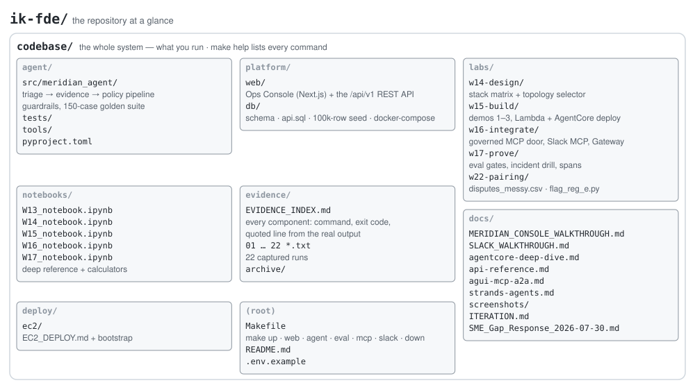

# IK FDE — The Meridian Engagement · codebase

Everything that runs lives in `codebase/`: the Meridian Ops Console (the bank's
portal and its REST API), the reference triage agent, the labs the class demos are
built from, the companion notebooks, and the dated evidence captures that prove
each component ran.



## Quick start

```bash
cd codebase
make up      # Postgres in Docker + schema + 100k-row deterministic seed + API keys
make web     # the Meridian Ops Console on http://localhost:3100
make agent   # the triage agent works dispute 29 and writes back into the portal
```

Nothing above needs an AWS account, an API key, or the internet. `make doctor`
checks prerequisites, `make verify` is the $0 smoke gate (prerequisites + smoke
eval + unit tests), and `make help` lists every target. `codebase/README.md` is
the full map.

## What's where

| Path | What it is |
|---|---|
| `codebase/agent/` | `meridian_agent`: the triage → evidence → policy pipeline, guardrails, the 150-case golden suite, tests |
| `codebase/platform/` | the Ops Console (Next.js) + the `/api/v1` REST API, Postgres schema and seed |
| `codebase/labs/w14-design/` | W14 terminal demos: scored stack matrix, integration-topology selector |
| `codebase/labs/w15-build/` | W15 demos 1–3, the Lambda + AgentCore deploy ladders |
| `codebase/labs/w16-integrate/` | the governed MCP door, the Slack MCP server, AgentCore Gateway |
| `codebase/labs/w17-prove/` | eval suites, the incident drill, the observability card |
| `codebase/labs/w22-pairing/` | the pair-programming exercise (`flag_reg_e.py`) |
| `codebase/notebooks/` | the per-week deep-reference notebooks (W13–W17), all runnable offline |
| `codebase/evidence/` | `EVIDENCE_INDEX.md`: every component with the command that proves it and a quoted line from the real output |
| `codebase/docs/` | console and Slack walkthroughs, API reference, AgentCore deep dive, screenshots |
| `codebase/deploy/ec2/` | one-shot bootstrap to host the portal on your own EC2 box |
| `.github/workflows/eval-gate.yml` | CI: smoke eval + unit tests + the 150-case golden gate on every PR touching the agent or the labs |

## The portal

| Where | How | URL |
|---|---|---|
| Hosted class instance (always on) | nothing to do | <https://ik-fde-casestudy-bank.vercel.app> |
| Your laptop | `make up && make web` | `http://localhost:3100` |
| Your own EC2 box | `codebase/deploy/ec2/EC2_DEPLOY.md` | `http://<dns>:3100` |

Sign in with a seeded analyst: `jason.soto@meridianbank.com` (Type A) or
`robert.joyce@meridianbank.com` (Type B). Email only; no password in this
training build.

## Working in your own fork

Learners fork this repo and build against it. `AGENTS.md` is the context file an
AI coding assistant reads first: the hard invariants, the locked stack, and the
gate each milestone must pass. Run `make verify` from `codebase/` before every
push; the PR gate runs the same checks.

## Ground rules

- Every demo has a $0 offline path. If something dies mid-run, switch to `--mock`
  and say so.
- The screenshots in `codebase/docs/screenshots/` are fallback captures, never
  live output.
- Tear down what you deploy: `./teardown.sh`, `agentcore destroy --force`,
  `make down`.
